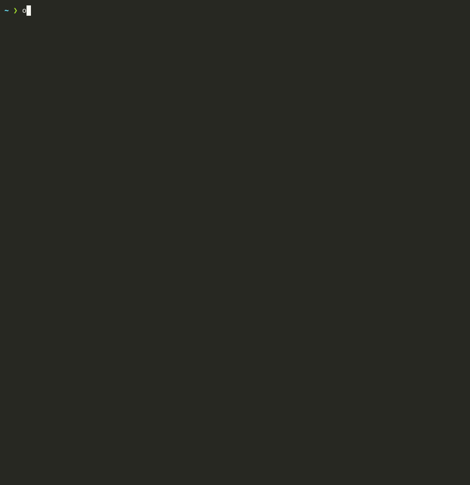
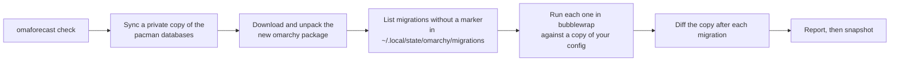

<h1 align="center">omaforecast</h1>

<p align="center">
  See what <code>omarchy update</code> will change in your config before you run it, and undo it with one command afterwards.
</p>

<p align="center">
  <a href="https://github.com/w-mir1/omaforecast/actions/workflows/ci.yml"></a>
  <a href="https://github.com/w-mir1/omaforecast/releases/latest"></a>
  <a href="LICENSE"></a>
</p>

<p align="center">
  <a href="#install">Install</a> •
  <a href="#quick-start">Quick start</a> •
  <a href="#how-it-works">How it works</a> •
  <a href="#compared-to-other-tools">Compared to other tools</a> •
  <a href="#safety-and-limitations">Safety and limitations</a> •
  <a href="#faq">FAQ</a>
</p>

<p align="center">
  
</p>

After the packages install, `omarchy update` runs migrations. These are shell scripts that edit files in your `~/.config`. Some of them rewrite files you customized, such as your bar layout in `shell.json` or your kitty settings. Omarchy's pre-update Snapper snapshot covers `/` but not your home directory, so it can't bring those files back.

omaforecast does three things:

- **Forecast.** It downloads the release the update would install and dry-runs each pending migration against a copy of your config in a sandbox. It lists every file each migration would change and marks the ones you customized.
- **Snapshot.** It saves your Omarchy config before every update.
- **Rollback.** `omaforecast restore` puts back everything the update changed, or one file. It saves a snapshot first, so you can undo the restore too.

Current release: **0.2.1**. It is one bash script. It needs no root, and the dry run uses bubblewrap.

## Install

```bash
curl -fsSL https://raw.githubusercontent.com/w-mir1/omaforecast/main/install.sh | bash
```

The installer downloads the script to `~/.local/bin/omaforecast`. It also adds a post-update hook and two rows to the Omarchy menu, Update › Forecast and Update › Config Rollback.

Optional. To snapshot automatically before every Omarchy upgrade, including one started from the bar's update icon, add the pacman hook. It asks for sudo once. The hook takes a fresh snapshot on every upgrade and prints a warning in the pacman output if it can't.

```bash
omaforecast setup --pacman-hook
```

The dry run uses [bubblewrap](https://github.com/containers/bubblewrap). Without it, omaforecast records static file mentions in the full report and exits 5 because no dry run was possible. Use `--no-sim` to request static details explicitly. Install it with `sudo pacman -S bubblewrap`.

## Updating omaforecast

`omaforecast update` updates Omarchy with a forecast first. To update the omaforecast tool itself:

```bash
omaforecast self-update             # confirm and install the latest version
omaforecast self-update --check     # exit 10 if newer, 0 if up to date
omaforecast self-update --yes       # install without a prompt
```

`upgrade` and `update --self` are aliases. `--force` reinstalls the same version or allows a downgrade. The download is checked before an atomic replacement, then setup refreshes your existing hook and menu choices. Git checkouts should use `git pull`. The optional pacman hook has a separate system copy; refresh it with `omaforecast setup --pacman-hook` after updating.

Interactive commands show a notice when a newer version is cached. The latest version comes from the script's `VERSION=` line and is cached in `~/.cache/omaforecast/latest-version` (or `$OMAFORECAST_CACHE/latest-version` / `$XDG_CACHE_HOME/omaforecast/latest-version`). Missing or stale data refreshes in the background, so a command never waits for the network. Checks happen at most once a day, including failed attempts; `OMAFORECAST_UPDATE_CHECK_INTERVAL` changes the interval in seconds.

Set `OMAFORECAST_NO_UPDATE_CHECK=1` to disable both notices and background checks. Non-interactive commands, CI, root, hooks, `--offline`, and quiet commands also skip them. `OMAFORECAST_REPO` (default `w-mir1/omaforecast`) and `OMAFORECAST_REF` (default `main`) select the source for both self-updates and notices, using the same variables as the installer. `OMAFORECAST_RAW_BASE` overrides the raw host for mirrors or local testing (`file://`, `http://`, or `https://`).

## Quick start

### Forecast the next update

```console
$ omaforecast check

omaforecast: what will the next Omarchy update do to your config?
Incoming: omarchy 4.0.3-1 → 4.0.4-1 (signature verified)
Pending migrations: 6 (they run as you, right after the packages install)
 6 migrations: 3 change your files · 1 create new files · 2 no changes
  ✗ 1788745941  Update Kitty configura: modifies ~/.config/kitty/kitty.conf [you customized this]
  ✗ 1791968925  Write the bar's tray wh: modifies ~/.config/omarchy/shell.json [you customized this]
  ✗ 1791969355  Split the bar's center: modifies ~/.config/omarchy/shell.json [you customized this]

Summary
 2 file(s) you changed would be rewritten. Also: 0 stock, 1 new.
 Full report: ~/.local/state/omaforecast/reports/omarchy_update_details_261019_14_04_UTC.md
 Full diff:   omaforecast check --diff  (saved to ~/.local/state/omaforecast/reports/omarchy_update_details_261019_14_04_UTC.diff)
 Snapshot saved: 20261019-140500-pre-update
 After the update, undo it with: omaforecast restore  (or one file: omaforecast restore <path>)
```

The default view summarizes migrations and shows an attention line for migrations that change your files, fail, or request `sudo`/`pkexec`. Every check, including `--no-sim`, `--quiet`, and checks with no pending migrations, saves full Markdown details in `~/.local/state/omaforecast/reports/omarchy_update_details_<YYMMDD>_<HH>_<MM>_UTC.md`. The timestamp is UTC when the check started. Runs in the same minute get `_2`, `_3`, etc.; concurrent runs reserve distinct names. Non-empty full diffs are saved next to their reports with the same stem and a `.diff` extension (including any collision suffix). `~/.local/state/omaforecast/last-forecast.md` is an atomic copy of the latest completed report. Reports and diffs are private (directory 700, files 600); the newest 20 reports and their paired diffs are kept (`OMAFORECAST_KEEP_REPORTS` changes this).

Use `omaforecast check --verbose` (also `--full` or `-v`) for the full per-migration terminal view, `--diff` to append diffs, or `--quiet` to write the report without terminal output except errors. Progress animates on stderr when it is a terminal, even with piped stdout. `OMAFORECAST_PROGRESS=0` disables it; `=1` forces it. After two migrations an estimated time remaining appears.


This example shows the short view. Add `--diff` to print each change.

### Update, then see what changed

Run `omarchy update` as usual, or `omaforecast update`, which asks before continuing if your customized files are affected. When the update finishes, the post-update hook prints a report. Here the pacman hook took a fresh snapshot just before the upgrade, so the report compares against that one.

```console
omaforecast: what the update changed in your config (since 20261017-191315-pre-update)
  added     ~/.config/fcitx5/conf/classicui.conf
  modified  ~/.config/kitty/kitty.conf
  modified  ~/.config/omarchy/shell.json

 See the diff:   omaforecast diff 20261017-191315-pre-update
 Undo all:       omaforecast restore 20261017-191315-pre-update
 Undo one file:  omaforecast restore 20261017-191315-pre-update ~/<path>
```

### Undo one file

```console
$ omaforecast restore ~/.config/kitty/kitty.conf --yes

Restore from snapshot 20261017-191315-pre-update (pre-update, 2026-10-17T19:13:17+00:00)
  put back   ~/.config/kitty/kitty.conf

Restored 1 file(s). Undo with: omaforecast restore 20261017-145015-pre-restore
```

### Undo everything the update changed

```console
$ omaforecast restore --delete --yes

Restore from snapshot 20261017-191315-pre-update (pre-update, 2026-10-17T19:13:17+00:00)
  remove     ~/.config/fcitx5/conf/classicui.conf
  put back   ~/.config/kitty/kitty.conf
  put back   ~/.config/omarchy/shell.json

Restored 3 file(s). Undo with: omaforecast restore 20261017-145016-pre-restore
Restart the Omarchy shell to pick up shell.json changes: omarchy-restart-shell
```

Without `--delete`, files the update added stay in place and the restore lists them. Leave out `--yes` to confirm first, or use `--dry-run` to only show the plan.

### All commands

| Command | What it does |
| --- | --- |
| `omaforecast check [--diff] [--offline] [--from PATH] [--allow-unsigned]` | Forecast the next update and take a snapshot |
| `omaforecast update [-y]` | Forecast, ask if your customized files are affected, then run `omarchy update` |
| `omaforecast self-update [--check] [--force] [--yes]` | Update omaforecast itself |
| `omaforecast report` | Show what the last update changed, and new `.bak` and `.pacnew` files |
| `omaforecast restore [SNAPSHOT] [PATH...]` | Put files back. Options are `--dry-run`, `--yes`, and `--delete` |
| `omaforecast diff [SNAPSHOT] [PATH...]` | Show changes since a snapshot. `--stat` lists files only |
| `omaforecast snapshot [LABEL]` | Take a snapshot now, for example before `omarchy refresh hyprland` |
| `omaforecast list` | List snapshots |
| `omaforecast setup` | Install the hook and menu rows. Options are `--pacman-hook`, `--menu-update`, `--no-menu`, and `--no-hook` |
| `omaforecast uninstall [--purge]` | Remove everything setup added |

`SNAPSHOT` is a snapshot id, part of one, `latest`, or `pre-update`. The default is the last pre-update snapshot. `check --exit-code` returns 3 when files you customized would be rewritten, and 4 when it couldn't save a snapshot, for use in scripts. It always returns 5 when the dry run couldn't start (no bubblewrap, or the system blocks user namespaces): then there is no forecast, and `omaforecast update` stops. `--no-sim` skips the dry run on purpose and records the files the migrations mention in the full report.

## How it works



Omarchy 4 ships as two pacman packages. `omarchy` has the commands, migrations, themes and shell. `omarchy-settings` has `/etc/skel` and the shipped defaults in `/usr/share/omarchy/config`. `omarchy update` upgrades them, then `omarchy-migrate` runs every script in `/usr/share/omarchy/migrations/` that has no marker yet in `~/.local/state/omarchy/migrations/`. Those scripts are the part of a normal update that writes to `~/.config`. Some call `omarchy-refresh-config`, which replaces a file with the shipped default and keeps a `.bak` copy. Others edit the file in place with `jq`, `sed`, or `awk`.

`omaforecast check` does the following.

1. It syncs a private copy of the package databases, the way `checkupdates` does, so the system's databases stay untouched. It downloads the new `omarchy` package to `~/.cache/omaforecast` and unpacks it. It checks the package's detached signature with `gpg`, against a copy of pacman's keyring and trust database, so the key must be one pacman would accept. A bad signature, or one from an unknown, untrusted, revoked or expired key, stops the check before any migration runs. A missing signature stops it when `pacman.conf` requires signed packages from that repo. `--allow-unsigned` overrides both. On the dev channel it uses the upstream branch of your `~/omarchy` checkout instead.

   If neither channel finds an incoming release, it uses `curl` and `tar` to download the newest release tag from [omacom/omarchy](https://github.com/omacom/omarchy). If the tags API fails or has no release tag, it tries the `quattro` branch tip instead. `Incoming:` identifies the tag or branch and says that this is an HTTPS source archive without a pacman package signature. This can forecast a release before it reaches your package mirror; migrations added after the latest tag appear only in the branch fallback or an explicit `--from` checkout. If source lookup also fails, it warns and checks installed migrations only. `--offline` skips all network access and checks the last fetched git upstream or installed tree.

2. It works out which migrations are pending for your user, the same way `omarchy-migrate` does.
3. It runs the pending migrations one at a time, in order, in a bubblewrap sandbox. The new release is mounted over `/usr/share/omarchy` and its `omarchy-*` commands over `/usr/bin`. The sandbox has a throwaway home with your tracked config and Omarchy's per-user state. Only your tracked, non-excluded config goes into that home, so a migration can't read `~/.ssh` or other private files. Only `/usr`, `/etc` and pacman's database in `/var/lib/pacman` are visible from the host, read-only, so files elsewhere such as `/opt`, `/srv`, `/mnt` or the rest of `/var` stay out. Keep secrets out of world-readable files in `/etc`: a migration can read those. `/run` is empty and there is no network. Stubs replace `sudo`, `systemctl`, `pacman` (except queries), `hyprctl`, notifications and service restarts, and record what the migration tried to run.
4. After each migration it diffs the throwaway home, so each change is tied to the migration that made it.
5. It compares each changed file with the default your current release shipped. An identical file is "stock". A different one is "you customized this". A file with no shipped default is "your file".
6. It also runs `pacman -Qkk` to find package files you edited by hand, which the upgrade will overwrite. It lists new upstream defaults for files you customized, which the update won't apply.
7. It saves a snapshot to `~/.local/state/omaforecast/snapshots/<id>/`. A snapshot is a plain directory you can browse. Unchanged files are hardlinks to the previous snapshot. omaforecast keeps the last 30.

A snapshot is published only after every file in it has been copied and compared with the original, and it carries a checksum list. `restore` refuses a snapshot whose checksums no longer match. Each snapshot also records which paths it looked at, everything that existed under them, and every symlink along the way. `restore --delete` uses that record to remove only files that provably didn't exist when the snapshot was taken.

### What it tracks

It tracks everything Omarchy ships into `~/.config`, read from `/usr/share/omarchy/config`. It also tracks other files migrations are known to edit. These include hypr, omarchy (shell.json, hooks, extensions, themed templates), the terminal configs, tmux, btop, nvim, helix, mise, systemd user units, `~/.local/share/applications`, `~/.bashrc`, and `~/.XCompose`.

Add paths to `~/.config/omaforecast/include`, one per line. Add glob patterns to skip to `~/.config/omaforecast/exclude`. Browser profiles, git internals, plugin checkouts, generated theme state, and Omarchy's `.bak` files are skipped.

Symlinked dotfiles from stow or chezmoi are saved by content. A restore writes through the symlink into your dotfiles repo, so the link stays a link.

## Compared to other tools

| Tool | What it does | Preview before an update | Saves `~/.config` | Undo |
| --- | --- | --- | --- | --- |
| Omarchy's Snapper snapshot | Btrfs snapshot of `/` before each update | No | No | Boot into the snapshot |
| `omarchy-refresh-config` `.bak` files | Copy of a file it resets to default | No | One file per reset | Copy it back by hand |
| [OmaPreflight](https://github.com/p134c0d3/omarchy-omapreflight) | Omarchy-aware preflight diagnostics and change reports | System diagnostics, not per-file config diffs | No | No |
| [Omarewind](https://github.com/vonsensey/omarewind) | Automatic git snapshots of your config, a visual timeline, per-file diffs | No | Yes | Yes, and the restore is undoable |
| [Red Pill](https://github.com/28allday/Red-Pill-Omarchy) | rsync hardlink snapshot backups and restore | No | Yes | Yes |
| [omadot](https://github.com/tomhayes/omadot) | GNU Stow wrapper for managing your dotfiles | No | Yes, in your repo | Through git |
| [mise dots proposal](https://github.com/omacom/omarchy/discussions/11029) | Git history of a tracked file list, labeled snapshots around migrations, optional sync between machines | No, shows what an update changed afterwards | Yes | Yes, per file |
| omaforecast | Dry run of the incoming migrations against your config | File-level, with diffs | Yes | One command |

OmaPreflight checks the system before an update. The backup tools keep copies and show what changed after an update ran. omaforecast runs the code of the release you are about to install and shows what it will change before you install it. It is a CLI rather than a bar widget, so it works over SSH, from a TTY, and in scripts. It works alongside any of the tools above.

## Safety and limitations

What omaforecast writes:

- `check`, `diff`, `list` and `report` write only to `~/.local/state/omaforecast` and `~/.cache/omaforecast`.
- `restore` writes the files it lists. It first saves a pre-restore snapshot that holds the current copy of every file it will change, and stops if it can't. Each file is replaced in one step, so an interrupted restore never leaves a half-written file.
- `restore` never writes through a symlink that is new or points somewhere else since the snapshot, and never deletes through a symlink at all. A stowed `~/.config/nvim` that links into your dotfiles repo is safe from `--delete`.
- A snapshot fails, and nothing is saved or pruned, when a tracked folder can't be listed or a file changes while it is copied. The error names the path. Fix its permissions or add it to `~/.config/omaforecast/exclude`.
- `restore --delete` keeps files the snapshot didn't look at, such as files that were unreadable, excluded, or outside the scope at the time.
- Snapshots, forecast diffs, and dry-run logs can contain secrets from your config. omaforecast creates them readable by you only.
- `setup` writes `~/.config/omarchy/hooks/post-update.d/50-omaforecast` and a marked block in `~/.config/omarchy/extensions/omarchy-menu.jsonc`. With `--pacman-hook` it also writes `/etc/pacman.d/hooks/90-omaforecast-snapshot.hook` and `/usr/local/lib/omaforecast/`.

The sandbox sees only read-only system folders, an empty `/run`, no network, and a writable throwaway home. omaforecast never writes into that home from outside. When it compares the results, it doesn't follow a symlink anywhere in a path the sandbox wrote, so a migration can't point it at files such as `~/.ssh`.

Limitations:

- The forecast covers what migrations do to your user's files. Changes to `/etc`, services and packages appear only as the commands a migration "also wants to run".
- A migration that depends on a live session, such as a running Hyprland or the shell's IPC, can behave differently in the sandbox. omaforecast says when a dry run exits with an error and keeps its log in `~/.local/state/omaforecast/sim-logs/`.
- AUR and mise updates in `omarchy update` aren't forecast.
- Without the pacman hook, an update you start some other way is covered only if you ran `omaforecast check` or took a snapshot first.
- The end-to-end test runs in an Arch container with packages built from Omarchy source. The dev-channel path and `omaforecast update` handing off to the real `omarchy-update` have no automated test yet.
- Filenames that contain newlines aren't supported.
- omaforecast is unofficial and not affiliated with Omarchy or 37signals.

## Uninstall

```bash
omaforecast uninstall          # removes the hooks, menu rows, and the script, and keeps snapshots
omaforecast uninstall --purge  # also deletes snapshots and cache
```

Your own entries in `omarchy-menu.jsonc` stay. The removal deletes only the lines between `// >>> omaforecast` and `// <<< omaforecast`.

## FAQ

**Does it change anything when I run `check`?**
No. It works on copies. The test checks that `~/.config` and the installed packages are identical before and after a forecast.

**Does it need root?**
No. Only the optional pacman hook needs sudo, once, to install.

**Why not use the Snapper snapshot?**
Omarchy's Snapper config snapshots `/` only. Your config lives in `/home`, so rolling back the system doesn't bring your config back. Rolling back also means rebooting into the snapshot.

**What if I don't have bubblewrap?**
`check` falls back to reading each migration and recording the files it names in the full report, with the same "you customized this" labels. It can't show diffs in that mode.

**Does it work with stow or chezmoi?**
Yes. Snapshots save the file content behind each link, and a restore writes through the link.

**Why did `check` stop with a signature error?**
The package it downloaded didn't verify against pacman's keyring, or it had no signature and your `pacman.conf` requires one. pacman would refuse that package too. Run `sudo pacman -Sy` and try again. Use `--allow-unsigned` only if you know why the signature is missing.

**Why did `check` stop with "bubblewrap can't create a sandbox"?**
The dry run needs an unprivileged user namespace, and some systems block them (Ubuntu 24.04 does through AppArmor, and some hardened kernels turn them off). With no sandbox there is no forecast, so `check` exits with code 5 and `omaforecast update` stops instead of guessing. Allow user namespaces (on Ubuntu: `sudo sysctl -w kernel.apparmor_restrict_unprivileged_userns=0`), or run `omaforecast check --no-sim` to see only the files the migrations mention.

**How much disk does it use?**
A snapshot of a typical Omarchy config is a few megabytes. Files that didn't change are hardlinks to the previous snapshot, and omaforecast keeps the last 30. Set `OMAFORECAST_KEEP` to change that.

**Can I use it before `omarchy refresh` or a theme change?**
Yes. Run `omaforecast snapshot`, then `omaforecast diff` and `omaforecast restore` afterwards.

## Testing

```bash
test/smoke.sh      # a few seconds, no root, no Docker
test/run-e2e.sh    # about 4 minutes, needs Docker
```

`test/run-e2e.sh` builds two pacman packages from a pinned Omarchy commit. The older one leaves out the six newest migrations, and the newer one has them. It installs the older package in an Arch container and creates a user from Omarchy's `/etc/skel`. It gives that user a personal keybinding, kitty remote control, a reworked bar, and their own menu entries. Then it publishes the newer package to a local repo and checks the following.

- `omaforecast check` finds the update, flags the two customized files the real migrations rewrite, leaves the keybinding alone, notices a hand-edited package file, and changes nothing on disk.
- The real `pacman -Syu`, the real `omarchy-migrate`, and Omarchy's post-update hook runner change exactly the files the forecast predicted.
- `omaforecast restore` brings `~/.config` back byte for byte, and the restore can be undone.
- Single-file restore, the fallback without bubblewrap, the menu file parsed the way Omarchy's shell parses it, and uninstall all work.
- A bad package signature, or one from an untrusted or revoked key, stops the forecast before any migration runs. A good one verifies. An unsigned package stops it when `pacman.conf` requires signatures.
- `restore --delete` leaves a stowed `~/.config/nvim` and its dotfiles repo alone.
- Snapshots, diffs, and logs are private.

`test/smoke.sh` also covers failed and damaged snapshots, `--delete` with unreadable or out-of-scope files, the undo copy of out-of-scope files, new symlinks, symlinks planted by a migration, signatures, and the piped installer.

The last run's output is in [test/last-run.log](test/last-run.log). CI runs shellcheck, the smoke test and the end-to-end test on every push.

## Contributing

See [CONTRIBUTING.md](CONTRIBUTING.md). Wrong forecasts are the most useful bug reports.

## License

[MIT](LICENSE) © Waqqas Mir
